<div align="center">

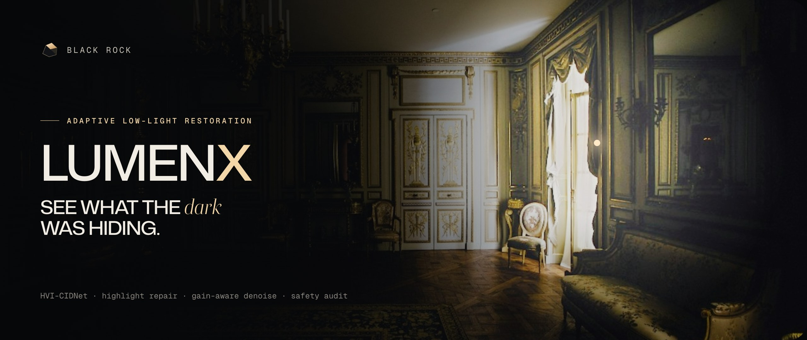

<br>

**Restore dark, noisy, unevenly lit photos and show every step of the reasoning.**
A deep model recovers the scene; classical vision repairs only what the network breaks; a safety audit reports the rest.

[](#the-problem)
[](#results)
[](#results)
[](core/)
[](server/)

<br>

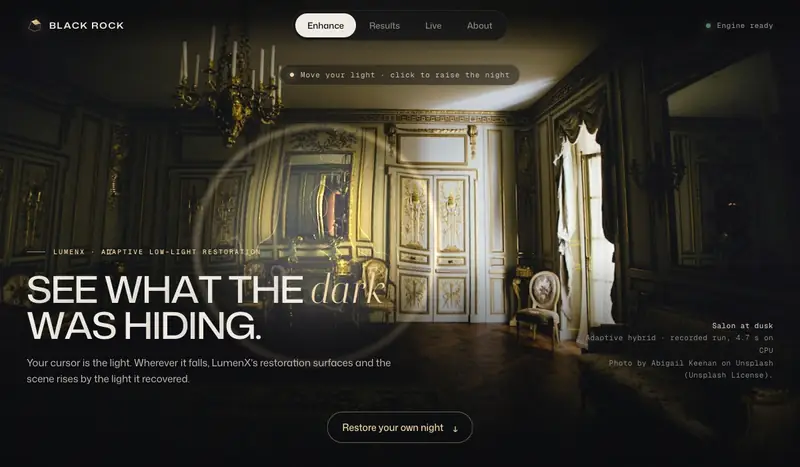

<sub><b>The landing page.</b> Your cursor is a light: wherever it falls, LumenX's real restoration of the photo appears. Click and the scene rises into 3D, shaped by the illumination map the engine measured.</sub>

<br><br>

*Team **Black Rock** · Nikhil Sridhara · Manoj D · Mohit D*

</div>

---

## The problem

Photos taken at night or indoors are dark, noisy and unevenly lit. Brightening them is easy; brightening them **well** is not:

- Simple gain amplifies sensor noise and washes out colour.
- Deep models restore tone beautifully but **blow out lamps and windows**: on the LOL-v1 benchmark, HVI-CIDNet alone clips **11.25%** of pixels to pure white.
- Neither tells you *where* it is confident and where it is guessing.

LumenX keeps the deep model's quality, repairs what it breaks, and shows its working.

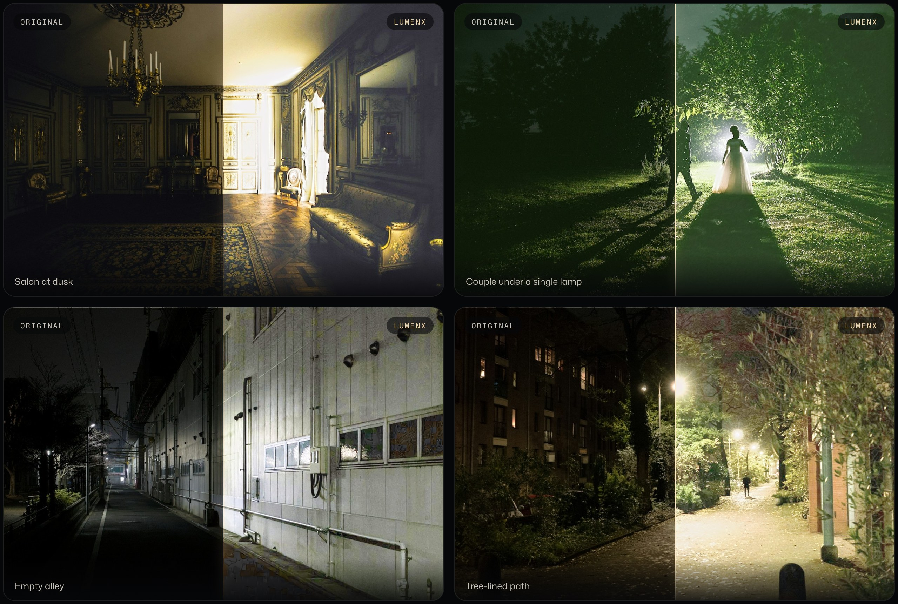

<sub>Real LumenX Hybrid output on four night photos (Unsplash), each split down the middle. Every image on this page is produced by the engine in this repository.</sub>

## What it does

| | |
|---|---|
| **Diagnose first** | Measures illumination, noise, signal-to-noise and how much real light was recorded before choosing anything, and says so in plain English. |
| **Restore with HVI-CIDNet** | A deep model brightens the scene in a colour space built for low light. |
| **Repair the highlights** | Where the network would blow out lamps and windows, a classical-prior mask blends in a protected copy pixel by pixel: **97.7% of blow-outs removed**. |
| **Denoise only where needed** | Grain is removed only where brightening amplified it. |
| **Audit every result** | Blown highlights, colour shift, detail loss and halos are checked and reported with their values, pass or flag. Nothing is silently "fixed". |
| **Stream the whole pipeline** | Every stage arrives in the browser as it happens, with an image, a caption and a timing. |
| **Compare the paths** | Hybrid, deep learning and classical on the same photo, side by side, with the best value per metric highlighted. |
| **Explain itself in 3D** | The recovered light becomes an orbitable WebGL terrain, and seven diagnostic maps can be laid over any result. |

### Watch it think

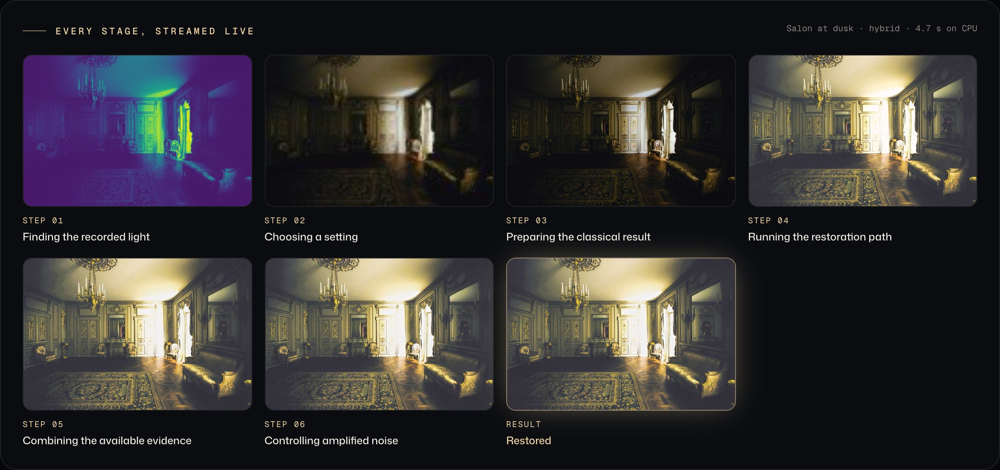

<sub>One recorded run on the landing photo. Each tile is the engine's real output at that stage; flat map stages are omitted.</sub>

## Screens

<table>
<tr>
<td width="50%">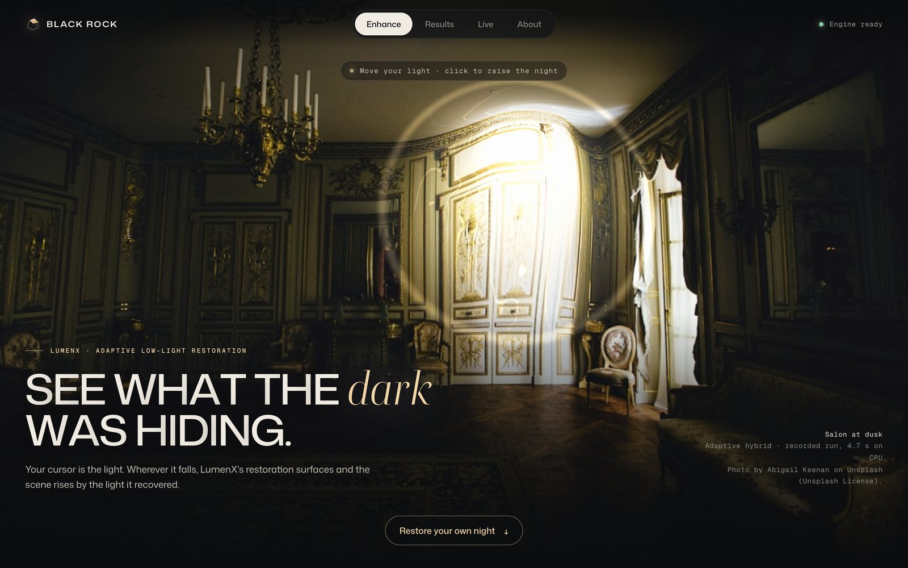<br><sub><b>A light in the dark.</b> The landing photo is a live WebGL surface; the cursor reveals the recorded restoration and lifts the scene where light was recovered.</sub></td>
<td width="50%">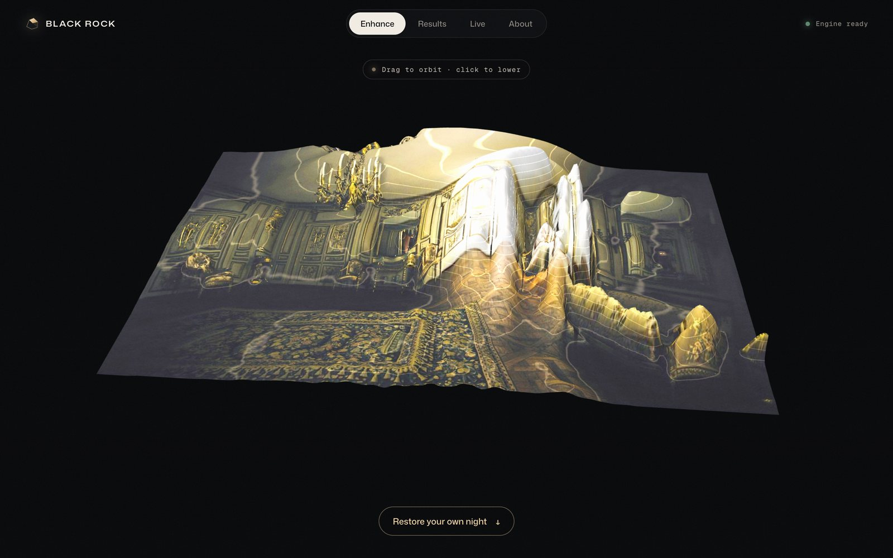<br><sub><b>Click to raise the night.</b> The restored salon as a 3D sculpture of its own illumination map, orbitable with the mouse.</sub></td>
</tr>
<tr>
<td>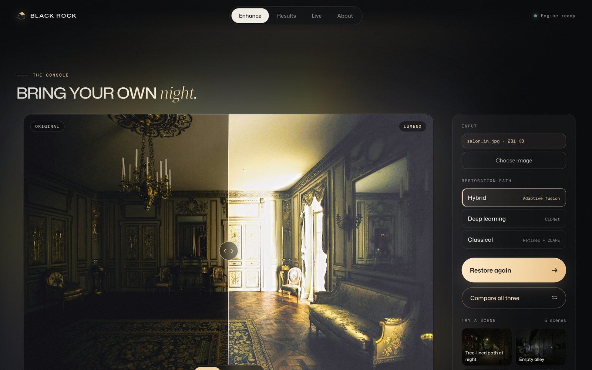<br><sub><b>Bring your own night.</b> Drag-and-drop, choose a path, and watch the eight-stage pipeline light up as the stream arrives. Drag the handle to compare, or switch to flashlight mode.</sub></td>
<td>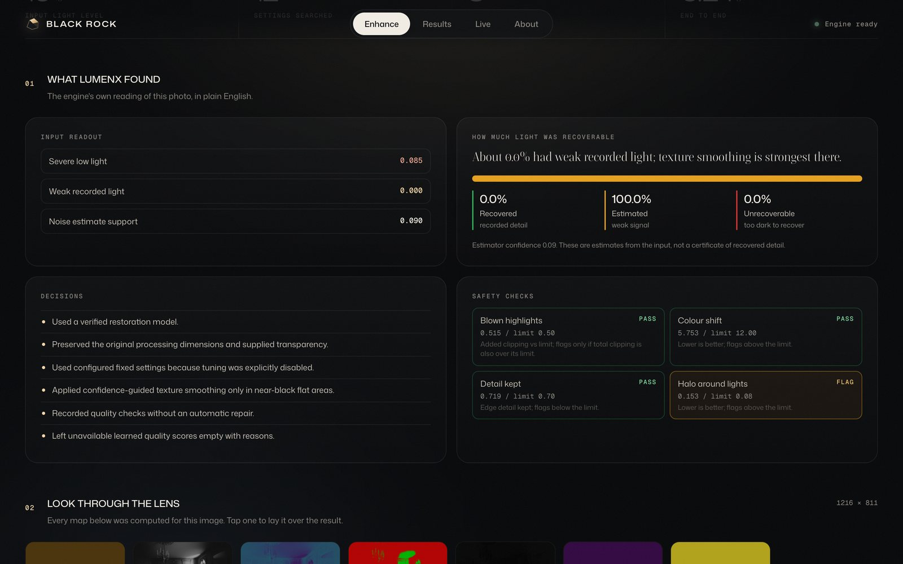<br><sub><b>What LumenX found.</b> Diagnosis chips, how much light was recoverable (recovered · estimated · unrecoverable), the decisions taken, and the safety audit with each check's rule.</sub></td>
</tr>
<tr>
<td>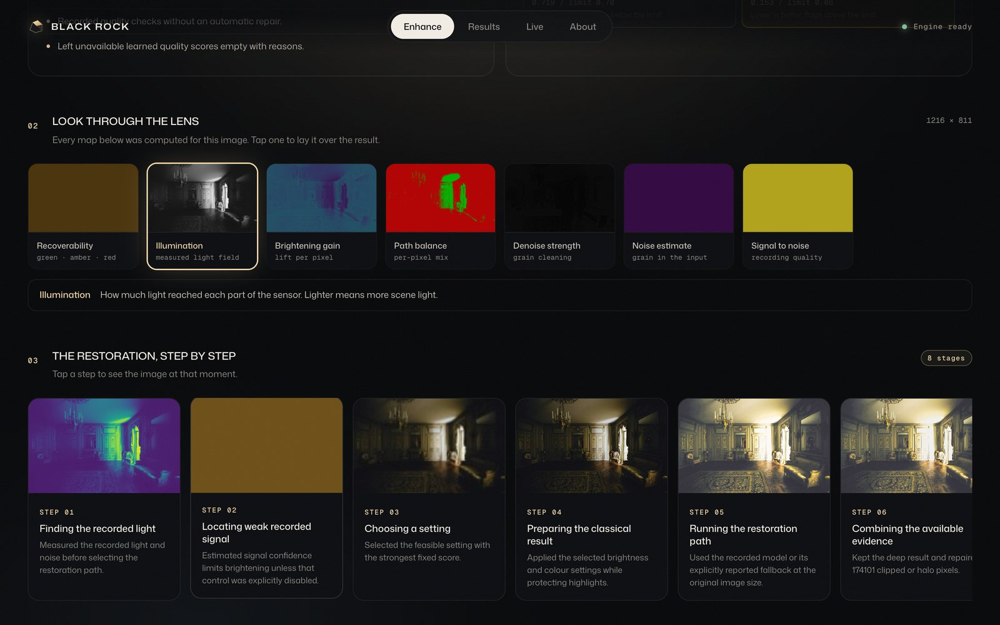<br><sub><b>Look through the lens.</b> Seven maps computed for the image, each with a one-line legend, and the restoration step by step with the engine's own captions.</sub></td>
<td>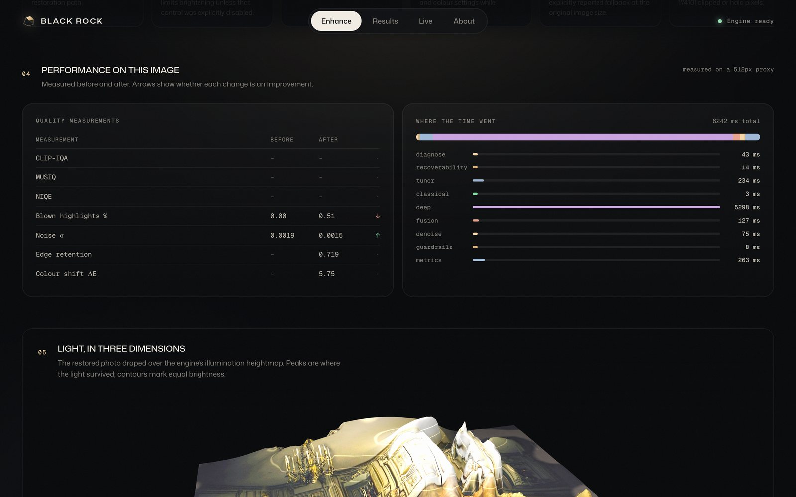<br><sub><b>Performance on this image.</b> Before/after quality measurements with honest arrows (unmeasured scores stay "–" with the reason), and where the time went.</sub></td>
</tr>
<tr>
<td>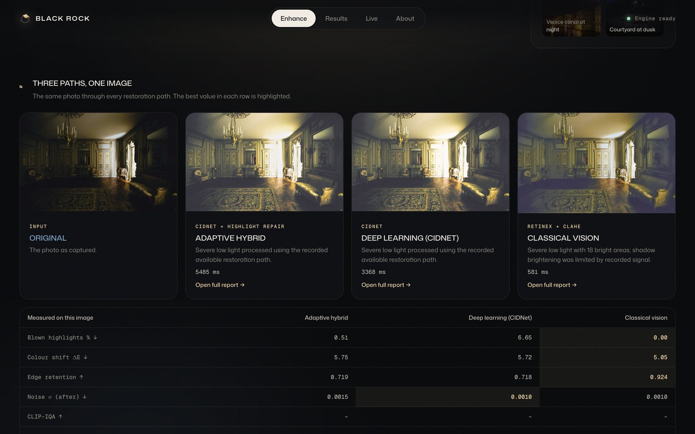<br><sub><b>Three paths, one image.</b> Hybrid, deep learning and classical run on the same photo; the table highlights the best value in each row.</sub></td>
<td>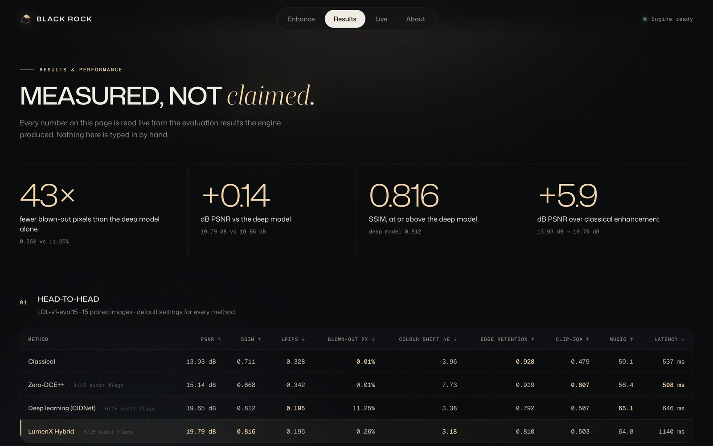<br><sub><b>Measured, not claimed.</b> The Results page reads the evaluation summary live: headline numbers, the head-to-head table, ablations, failure analysis and every dataset.</sub></td>
</tr>
<tr>
<td>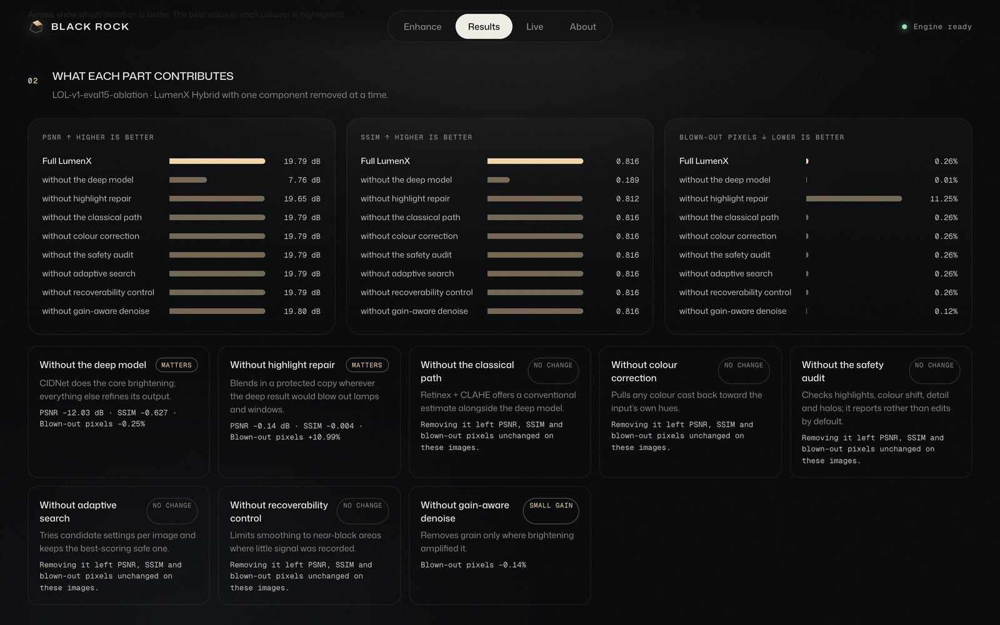<br><sub><b>What each part contributes.</b> One component removed at a time, with a plain verdict, including the ones that change nothing on this set.</sub></td>
<td>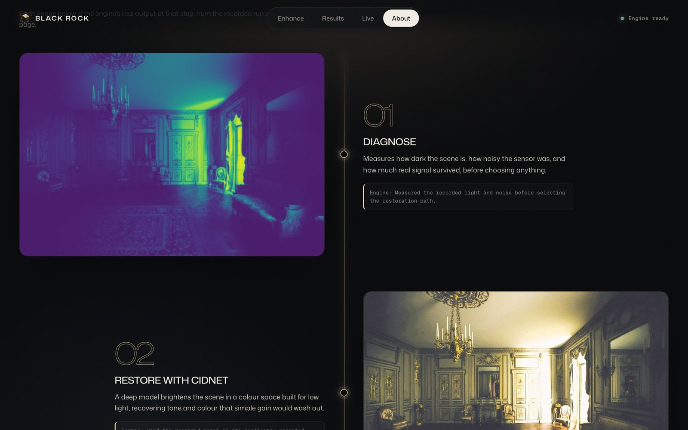<br><sub><b>How it works, shown.</b> The About page walks the five steps using the recorded run's real stage outputs and engine logs.</sub></td>
</tr>
</table>

## How it works

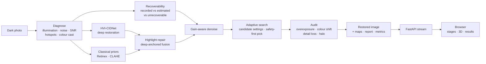

Three rules run through the system:

- **Deep-anchored, classically repaired.** CIDNet decides the image; classical vision only corrects where it measurably fails (clipped highlights, halos). An earlier design that averaged the two was too dark (12.21 dB) and was replaced.
- **Nothing is silently invented.** Unmeasured metrics are `null` with a reason, recoverability is labelled an estimate, and the audit reports instead of re-editing (automatic re-repair dropped SSIM from 0.816 to 0.721, so it was removed).
- **Every stage is visible.** The engine emits each stage with an image, a caption and a timing; the UI streams them as they arrive, so judges can inspect a result instead of trusting it.

Full design: [`docs/ARCHITECTURE.md`](docs/ARCHITECTURE.md) · [`docs/DESIGN_DOCUMENT.md`](docs/DESIGN_DOCUMENT.md) ([PDF](docs/Hackathon_Technical_Solution_Report_LumenX.pdf)) · API: [`server/docs/API.md`](server/docs/API.md) · engine contract: [`CONTRACT.md`](CONTRACT.md)

## Results

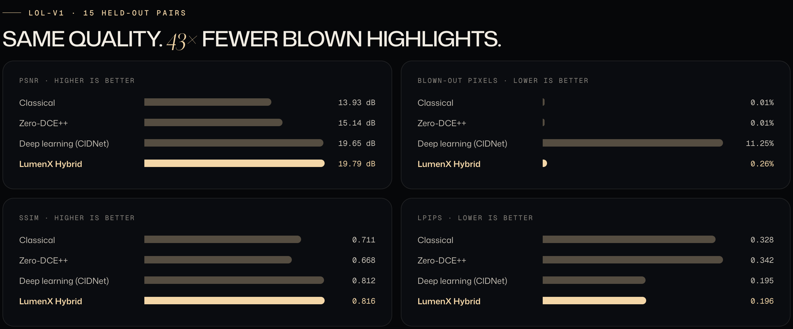

LOL-v1 `eval15`, 15 held-out paired images, NVIDIA RTX 2050 (FP16):

| Approach | PSNR ↑ | SSIM ↑ | LPIPS ↓ | Blown-out px ↓ | Colour shift ΔE ↓ | Edge retention ↑ | Latency |
|---|---|---|---|---|---|---|---|
| Classical only | 13.93 | 0.711 | 0.328 | 0.007% | 3.96 | **0.928** | 537 ms |
| Zero-DCE++ (pretrained) | 15.14 | 0.668 | 0.342 | 0.009% | 7.73 | 0.919 | 508 ms |
| Deep learning only (HVI-CIDNet) | 19.65 | 0.812 | **0.195** | 11.25% | 3.38 | 0.792 | 646 ms |
| **LumenX Hybrid** | **19.79** | **0.816** | 0.196 | **0.26%** | **3.18** | 0.810 | 1140 ms |

**The hybrid matches the deep model on fidelity (+0.14 dB PSNR, +0.004 SSIM, equal LPIPS) while cutting blown-out pixels 43×**, lowering colour shift and keeping more edge detail.

**Ablation** (one component removed at a time): without the deep model PSNR falls by 12 dB; without highlight repair blown-out pixels jump back to 11.25%. Recoverability and colour correction change nothing on LOL-v1 (no near-black regions or strong casts), and the table says so. **Fine-tuning** Zero-DCE++ on LOL lowered held-out PSNR (13.43 vs 15.14 dB), so the pretrained weights stay.

Full tables, ablation and failure analysis: [`eval_P1_Blackbox.md`](eval_P1_Blackbox.md). The same numbers are served live by `GET /benchmarks` and rendered on the app's Results page.

## Where it still fails

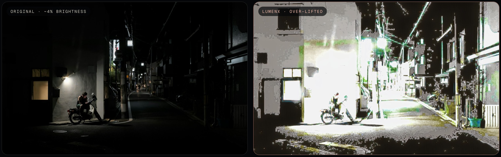

<sub>A near-black street (about 4% brightness): the restoration over-lifts the scene and bands in the sky and walls. Shown deliberately.</sub>

- **Near-black, low-bit-depth photos** can be over-lifted with visible banding, as above.
- **Detail loss in very dark, noisy regions** (flagged on 5/15 LOL test images): the network smooths texture that was never recorded.
- **A halo near one sharp lamp edge** (image 748).
- **Large photos are tiled on CPU** (above about 1 MP); tiles are corrected separately and can leave faint brightness seams.
- **The adaptive search costs about 0.5 s per image** and kept the minimal-correction candidate on every LOL test image: it is a safety net, not a quality booster.

## Run it

### Option A: one command (Docker, CPU)

```bash
docker build -t lumenx . && docker run -p 7860:7860 lumenx
```

Open http://localhost:7860. The image installs everything, downloads the model weights and the demo gallery at build time. The same Dockerfile deploys as a Hugging Face Space.

### Option B: local Python (uses an NVIDIA GPU automatically if present)

Python 3.11, from the repository root (PowerShell shown; use `source .venv/bin/activate` on Linux/macOS):

```powershell
python -m venv .venv
.venv\Scripts\activate
# GPU: CUDA 12.4 build. For CPU only, use --index-url https://download.pytorch.org/whl/cpu
pip install torch==2.6.0 torchvision==0.21.0 --index-url https://download.pytorch.org/whl/cu124
pip install -e "core[models,iqa]" -e server
pip uninstall -y opencv-python opencv-python-headless
pip install --force-reinstall --no-deps opencv-contrib-python==4.11.0.86
python core/scripts/download_weights.py
python server/scripts/fetch_demo_photos.py
$env:LUMENX_ENGINE = "real"
python -m uvicorn lumenx_server.main:app --app-dir server --port 8000
```

Open http://localhost:8000. `GET /health` reports `"device": "cuda:0"` or `"cpu"`. The two OpenCV lines matter: `pyiqa` installs plain `opencv-python`, which hides the `opencv-contrib` guided filter LumenX needs.

**No GPU or weights?** Set `$env:LUMENX_MOCK = "1"` to run the full UI against the built-in mock engine (clearly labelled MOCK).

**Hosting the frontend separately** (Vercel, Netlify, GitHub Pages): see [`server/lumenx_server/frontend/DEPLOY.md`](server/lumenx_server/frontend/DEPLOY.md).

### Command line

```powershell
python -m lumenx_core.cli enhance path\to\dark.png out_dir --mode hybrid   # or classical | dl | zerodce
```

### Reproduce the evaluation

1. Download LOL-v1 (optionally LOL-v2, LIME, DICM or your own unseen images). Datasets are not stored in this repository.
2. Set the dataset paths at the top of `server/eval/run_final_eval.ps1`.
3. `powershell -ExecutionPolicy Bypass -File server/eval/run_final_eval.ps1`

This writes `server/results/benchmark_summary.{csv,json,svg}` and `failure_review.csv`, which the app serves through `GET /benchmarks`. Runs are resumable; CPU runs give the same quality metrics with slower latency.

## Repository layout

```
core/                      lumenx-core: the processing engine
  lumenx_core/             diagnosis, classical CV, HVI-CIDNet, Zero-DCE++, fusion, tuner, guardrails, metrics
  lumenx_core/config/      default.yaml: every tunable, documented
  scripts/                 weight download, benchmarking, Zero-DCE++ training
  tests/                   engine contract and model tests
server/                    lumenx-server: FastAPI app, streaming API, evaluation
  lumenx_server/frontend/  the web app: WebGL landing scene, live pipeline, results, about
  eval/                    resumable evaluation, aggregation, failure mining
  results/                 published benchmark summary and failure review
  scripts/                 demo gallery and landing-scene recording
docs/                      architecture, design document, report PDF, README assets
```

## Ethics and responsible use

- **Enhancements, not evidence.** The model may smooth or alter fine detail, and regions with too little recorded light are flagged rather than invented. Do not use LumenX for forensic, surveillance or identification decisions.
- **Privacy.** Uploaded images stay on the server in a bounded run history and are never sent to third-party services. No secrets or credentials are stored in this repository.
- **Licences.** HVI-CIDNet is MIT-licensed; Zero-DCE++ weights are CC BY-NC 4.0 (non-commercial research use only). Datasets are used under their research terms and are not redistributed.

## Team

**Team Black Rock**

| | | |
|---|---|---|
| [**Nikhil Sridhara**](https://github.com/ai4333) | 1RUA24CSE0283 | Frontend: WebGL landing scene, streaming interface, results and about pages, README |
| [**Manoj D**](https://github.com/ManojDevaraj) | 1RUA24CSE0242 | Engine integration and releases, server, evaluation and results |
| [**Mohit D**](https://github.com/MohithD05) | 1RUA24CSE0280 | Original enhancement engine, Zero-DCE++ fine-tuning |

## Credits

HVI-CIDNet (Yan et al., MIT) · Zero-DCE++ (Li, Guo & Loy, IEEE TPAMI 2021, CC BY-NC 4.0) · LOL-v1 (Wei et al., BMVC 2018) · pyiqa (Chen et al.). Demo photos by Abigail Keenan, Fons Heijnsbroek, Julien (domsson) and Julio Lopez on [Unsplash](https://unsplash.com) under the Unsplash License; LIME benchmark images via the Zero-DCE repository. Type: Mona Sans and Geist Mono (SIL OFL), Boska (ITF Free Font License).
