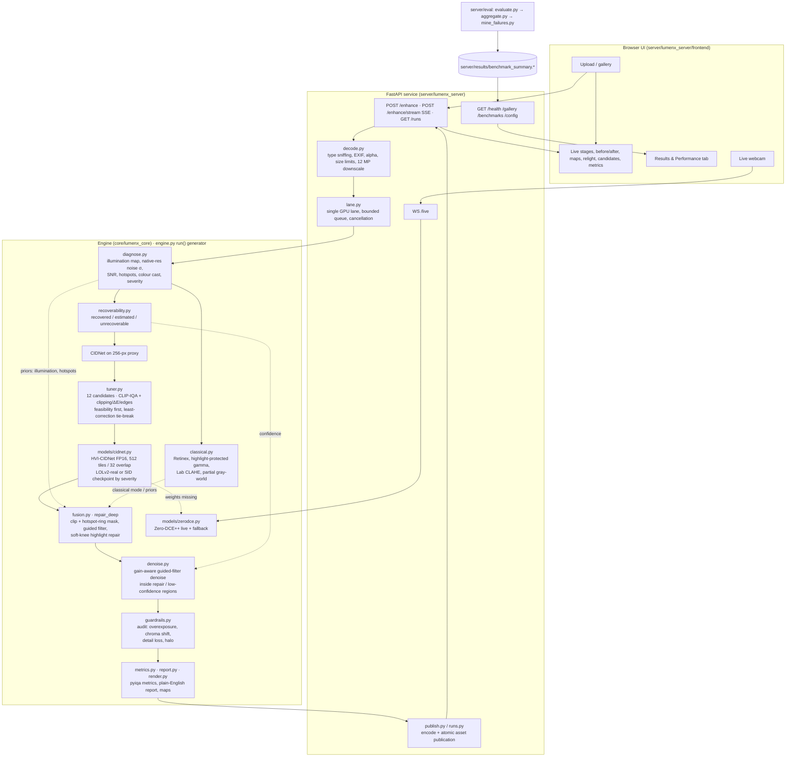

# LumenX System Architecture

Team **Black Rock** · Problem **P1: Robust Low-Light Image Restoration and Enhancement** · engine `core-v0.4.3`

LumenX has two parts joined by one frozen interface ([`CONTRACT.md`](../CONTRACT.md)):

- **`core/` (`lumenx-core`):** the processing engine: diagnosis, classical CV, deep models, hybrid fusion, metrics and report text.
- **`server/` (`lumenx-server`):** the FastAPI service, upload handling, streaming, scheduling, evaluation harness and web UI.

## System diagram

## Processing modes

| Mode | Path | Used for |
|---|---|---|
| `classical` | diagnose → recoverability → classical → denoise → audit | classical-only baseline |
| `dl` | diagnose → recoverability → CIDNet → audit (output untouched) | deep-learning-only baseline |
| `zerodce` | diagnose → recoverability → Zero-DCE++ → audit | evaluation baseline, live webcam |
| `hybrid` (default) | full path in the diagram | the proposed system |

**Hybrid principle (deep-anchored):** the output equals the CIDNet output everywhere except inside a repair mask. The mask is built from classical priors (pixels CIDNet clipped at ≥ 0.98, plus overshoot rings around hotspots from the illumination map) and smoothed with a guided filter on input luminance. Inside the mask, the image blends toward a hue-preserving soft-knee highlight compression, with gain-aware denoising. Guardrails audit and report, but don't re-process (an automatic re-repair pass over-smoothed and was removed, see the ablation).

## Module map

| Concern | File |
|---|---|
| Public interface, request/result types | `core/lumenx_core/contracts.py`, `contract_check.py` |
| Orchestration, stage events, modes, ablation flags | `core/lumenx_core/engine.py` |
| Diagnosis / recoverability | `diagnose.py`, `recoverability.py` |
| Classical CV (Retinex, CLAHE, colour) | `classical.py` |
| Gain-aware edge-preserving denoise | `denoise.py` |
| Deep models, placement, FP16, tiling | `models/cidnet.py`, `models/zerodce.py`, `models/registry.py`, `models/runner.py` |
| Hybrid fusion / highlight repair | `fusion.py` |
| Adaptive candidate search | `tuner.py` |
| Guardrail audit | `guardrails.py` |
| Metrics (PSNR, SSIM, LPIPS, CLIP-IQA, MUSIQ, custom) | `metrics.py` |
| Report text, map rendering | `report.py`, `render.py` |
| All thresholds and weights | `core/lumenx_core/config/default.yaml` |
| Upload decoding, limits | `server/lumenx_server/decode.py` |
| GPU lane, queue, cancellation | `server/lumenx_server/lane.py` |
| HTTP / SSE / WebSocket routes | `server/lumenx_server/app.py` |
| Evaluation, aggregation, failure mining | `server/eval/evaluate.py`, `aggregate.py`, `mine_failures.py`, `run_final_eval.ps1` |

## Runtime

- PyTorch 2.6, FP16 on CUDA (validated on an RTX 2050, 4 GB: peak 407 MiB at 1080p and 12 MP), FP32 on CPU. Device is chosen automatically.
- Model fallback chain: CIDNet → Zero-DCE++ → classical. Every fallback is reported in the response `provenance`.
- One engine lane: still-image requests are serialised; live webcam frames use a latest-frame slot and pause while a still request runs.
- Deterministic for a fixed input, configuration and checkpoint on the same machine.
