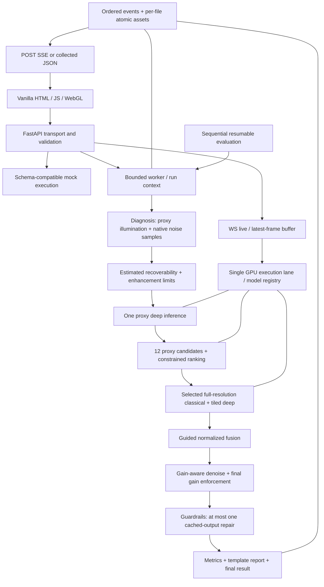

# LumenX Final Architecture and Implementation Plan

Date: 2026-11-06

Status: **Planning complete; implementation awaits user approval.** Creating this document does not authorize implementation. Approval adopts the explicit requirement interpretations below. Existing analysis, review, and requirement documents remain unchanged.

## 1. Scope, authority, and final outcome

This plan consolidates the complete contents of:

- `MASTER_PROMPT.md`
- `AGENTS.md`
- `CODEX_ANALYSIS.md`
- `ANTIGRAVITY_ANALYSIS.md`
- `CODEX_REVIEW.md`
- `ANTIGRAVITY_REVIEW.md`

The product is a backend-first, recoverability-aware low-light restoration engine with a replaceable reference frontend. It must improve visibility, restrain enhancement where input evidence is weak, expose its decisions, and provide reproducible evaluation. No additional enhancement models, model training, paid services, runtime LLMs, distributed queues, or frontend framework are in scope.

The original requirements govern except for the ambiguities explicitly resolved in section 2. Targets are acceptance criteria, not claims of measured performance. A missed target remains a failed gate until corrected or explicitly changed by the user.

Implementation lives under `<project-root>/lumenx/`, following the master prompt's outer directory and inner Python package. All implementation paths below are relative to that outer directory. Run `uvicorn api.main:app` from `<project-root>/lumenx/`. The six source documents and this plan remain in the project root.

## 2. Final decisions resolving the reviews

| Topic | Final decision | Reason |
|---|---|---|
| Recovery terminology | Keep API class names `recovered`, `estimated`, `unrecoverable` and the Recoverability Map title. Define the map as an input-based estimate; reports describe measured evidence and actions without guaranteeing factual detail. | Preserves the interface and clear narrative without claiming proof from a single image. |
| Clipping-aware confidence | Penalize jointly near-black RGB/luminance with low local variance, plus weak estimator confidence. Do not declare a region unrecoverable merely because one channel is near zero. | A saturated red or blue object can have a zero channel and strong useful signal. |
| Image resolution | Process images up to 12 MP at their normalized input resolution. Downscale inputs above 12 MP and disclose original and processed sizes. Do not silently downscale all uploads to 1080p. | The brief requires full-resolution output and only authorizes downscaling beyond its input limit. |
| Latency scope | The 1.5-second acceptance target applies to warm, uncached 1080p GPU processing, including all required outputs. Larger inputs and CPU processing have measured latency but no 1.5-second claim. | Resolves the conflicting broad definition of done without reducing output quality. |
| Still-image fallback | CIDNet unavailable or unusable → Zero-DCE++ → classical path. Zero-DCE++ is also the live model. Every transition is reported. | Resolves the live-only versus still-fallback conflict. |
| Streaming method | `POST /enhance/stream`, consumed using streaming `fetch`. | Supports multipart uploads and the authoritative API listing. |
| Search | Twelve deterministic candidates, required CLIP-IQA/NIQE/custom scoring, diagnosis priors, conservative and exploratory candidates. No automatic reduction to eight or custom-only scoring to claim compliance. | Keeps adaptation and evaluation comparable to the brief. |
| Full-resolution order | Tune before producing selected full-resolution classical, fusion, and denoised outputs. Proxy candidates are explicitly proxy assets. | Avoids reporting stages generated with parameters other than the winner. |
| Model lifecycle | Initialize and deserialize once at startup; retain CPU model objects; serialize large-model inference; use a startup-selected placement policy described in section 5. | Avoids per-request reconstruction and unsupported coexistence assumptions. |
| Artifact atomicity | Atomically publish each file as it becomes ready; publish `result.json` last. | Whole-run directory publication at the end would prevent useful live stage URLs. |
| Adaptive routing | No mean-only deep bypass, tile skipping, or automatic mode substitution in the approved initial build. Identity-like candidates and spatial weights provide restraint. | Preserves mode semantics and avoids a new seam-prone optimization. |
| Licensing | Record source, checkpoint, and licence restrictions in weight/dependency documentation. No licence investigation project or extra approval stage. | Meets attribution needs without treating noncommercial terms as unrestricted open-source rights. |

## 3. Final system architecture

### 3.1 Request execution

1. Validate upload, decode, normalize EXIF orientation and colour, preserve alpha, and enforce decoded-size limits.
2. Build a typed run context with normalized input, frozen configuration, deterministic seed, input/config hashes, requested mode, and timing origins.
3. Diagnose brightness, illumination, local noise, SNR, hotspots, colour cast, clipping, and severity. Compute input-only recoverability and noise-estimate confidence.
4. In hybrid mode, run the selected checkpoint once on the 256-pixel proxy. Evaluate twelve cheap proxy candidates while reusing that result.
5. Run the selected classical parameters at full resolution. Run the chosen deep path at full resolution, tiled above 1 MP. Classical and deep are independently callable; initial orchestration is sequential and deterministic.
6. Smooth, clamp, and normalize fusion weights; blend classical, deep, and safe paths.
7. Compute gain-aware denoising, preserve reliable edges, and enforce actual output gain limits in weak-signal areas after processing.
8. Check guardrails. If needed, execute exactly one repair using cached diagnosis, illumination, and deep output. Recheck and record both attempts. If unresolved, select the conservative classical/safe result and disclose remaining failed checks; no unbounded retry.
9. Compute required before/after metrics, publish final assets, generate the explanation and story from recorded decisions, persist `result.json`, and emit `done`.

Stage previews and candidate thumbnails are encoded/published as their stages finish, not delayed until step 9. No artificial stage delays in real execution. Large arrays remain internal; only metadata and URLs enter API events.

### 3.2 Modes and ablations

- `classical`: diagnosis and classical restoration, without deep inference or fusion. Use diagnosis-derived parameters. Gain-aware denoising, gain controls, and guardrails apply as restoration safeguards. Report the precise processing recipe.
- `dl`: direct selected CIDNet output, or explicitly reported fallback. Diagnostics, maps, metrics, and guardrail audit remain available, but no hybrid fusion, tuner, colour correction, or post-denoising modifies a successful CIDNet result. Guardrails are audit-only for this baseline. This preserves a meaningful DL comparison.
- `hybrid`: the full adaptive pipeline. This is the mode evaluated against all system targets.
- `no_tuner`: use configured fixed defaults and mark tuning disabled.
- `no_fusion`: deep-only output; equivalent to the DL baseline recipe. Other disabled-component flags that cannot affect it are recorded as inactive.
- `no_classical`: exclude the classical contributor; normalize deep/safe weights.
- `no_dl`: exclude deep inference; normalize classical/safe weights.
- `no_gain_denoise`: use configured uniform denoising while retaining independent gain caps.
- `no_recoverability`: continue computing diagnostic visualization, but disable confidence-driven fusion, gain caps, and denoise modulation. This permits a genuine component ablation.
- `no_guardrails`: disable automatic repair; still compute audit values for evaluation without modifying output.
- `no_color_correction`: bypass classical colour correction.

Ablations are supported on hybrid requests. Reject unknown flags and contradictory combinations such as `no_dl` with `no_fusion`, or disabling both classical and deep. Reject ablation lists on non-hybrid modes rather than silently ignoring them. Evaluation runs one flag at a time. Baselines have fixed, documented recipes; do not silently give one method extra postprocessing.

## 4. Component breakdown and algorithm decisions

| Component | Final implementation responsibility and output |
|---|---|
| `utils.py` | Shared frozen config access, internal dataclasses, image normalization, RGB/Lab conventions, proxy geometry, timing, run context, GPU gate/model registry, atomic file helper, hashes and logging. No imports from API modules. |
| `diagnose.py` | 512-long-side illumination proxy using max-channel guided filtering; native-resolution deterministic flat-patch MAD noise estimates and interpolated block map; brightness, clipping, hotspots, cast, SNR, and severity. |
| `recoverability.py` | SNR soft score modified by joint near-black clipping and estimator confidence; guided boundary smoothing; three-class display; percentages; gain-limit map. Keep the confidence of noise estimation separately available. |
| `classical.py` | Retinex decomposition, highlight-protected illumination gamma, Lab CLAHE, partial cast correction; output image, reflectance, and adjusted illumination. Identity/conservative parameter settings are valid. |
| `deep/cidnet.py` | Official architecture wrapper, LOLv2-real for mild/moderate/severe and SID for extreme; FP16 CUDA, FP32 CPU, stride padding, 512 tiles/32 overlap, cosine blending; checkpoint and precision metadata. |
| `deep/zerodce.py` | Official Zero-DCE++ wrapper, live inference and documented still fallback; no additional enhancement model. |
| `fusion.py` | Required deep/classical/safe weights from illumination and recoverability; guided smoothing; nonnegative normalization with safe fallback; RGB fusion visualization. |
| `denoise.py` | Required gain/noise strength map, three guided-filter strengths blended spatially, chroma suppression, reliable-edge protection. Avoid optional non-local means in the initial build. |
| `tuner.py` | Twelve candidates at a 256-long-side proxy: ten seeded LHS samples (eight prior-focused, two broader), one conservative candidate, one identity-like candidate; deep proxy reuse; configured scoring and feasibility ranking; all thumbnails and scores. |
| `metrics.py` | Cached pyiqa wrappers, metric direction and availability, fixed score normalization, reliable-structure edge retention, chroma-only Delta E, noise and clipping measures; paired/evaluation metrics. |
| `guardrails.py` | Incremental clipping, midtone chroma shift, reliable-edge loss, hotspot overshoot; masks and one deterministic repair decision. |
| `report.py` | Templates from actual recorded facts; headline, chips, 4–7 decisions, ordered story, recovery summary, captions of at most 20 words; technical detail isolated in `tech_note`. |
| `viz.py` | Stage previews, colormaps, RGBA overlay, map exports, 128×128 heightmap, image encoding, and asset publication through the shared atomic helper. |
| `pipeline.py` | Mode/ablation validation, dependency ordering, model calls, candidate selection, intermediate reuse, bounded retry, event emission, and complete internal result. |
| `api/*` | Pydantic transport contracts, startup/readiness, worker bridge, endpoints, mock engine, static assets, live backpressure. |
| `frontend/*` | Required upload/gallery, comparison, streaming stages, overlays, maps, relight, candidates, decisions, metrics/timings, mode comparison, live, benchmarks; semantic data roles and CSS variables. |
| `scripts/*` | Weight acquisition, warmup, resumable evaluation/ablation, failure mining, and reproducible exports. |

### 4.1 Confidence and metrics corrections

- Native noise patch selection is deterministic, with up to 100 valid flat 32×32 patches, configurable minimum count and interpolation. Tiny images use an explicit small-image estimator; no valid samples produce a low estimator-confidence status and configured conservative estimate.
- Near-black handling requires low luminance/joint RGB darkness and low local variance. A single dark colour channel is only a channel-clipping statistic, not proof of absent detail.
- Keep mathematical zero-noise and zero-signal cases finite. A flat black image must never receive high confidence because of an epsilon denominator.
- Guardrail Delta E uses equal reference lightness for input/output Lab values, restricting comparison to valid midtones and excluding saturation. Label the metric `chroma_delta_e`; retain legacy `delta_e` with documented identical semantics.
- Edge retention uses sufficiently supported, high-confidence input structures. If there are no usable edges or correlation is undefined, return unavailable with a reason, not a fabricated pass or numeric NaN.
- Candidate ranking first excludes hard guardrail violations, then applies the required normalized CLIP-IQA, negative NIQE, clipping, colour, and edge score. Missing applicable custom measures have documented neutral handling; missing required IQA is a degraded run. If every candidate is infeasible, select the conservative candidate, retain its failed checks, and disclose the condition.
- Use fixed configured normalization, not per-request min/max scaling. Preserve raw subscores, normalized contributions, feasibility reasons, deterministic tie-breaking, and exactly one chosen candidate.

## 5. Model, memory, concurrency, and degradation policy

### 5.1 Lifecycle

At startup, initialize available model objects and metric objects once, verify checkpoint hashes, set eval/no-gradient behavior, and retain CPU copies/objects as necessary. Offline evaluation metrics not needed by online requests stay CPU-resident until their scheduled evaluation work. Download nothing inside a request.

Startup selects one placement policy for the session using measured free/peak memory and a configured reserve:

1. Attempt residency of the required online model weights on GPU with serialized activations. Keep a memory reserve and verify the worst tile plus IQA batch before accepting this policy.
2. If unsafe, retain initialized objects on CPU and transfer only the active model to GPU for each phase. Move the previous model back before the next transfer. Do not deserialize or reconstruct models each request. Include transfer time in latency.

This is one model-manager policy with a deterministic capacity fallback, not two competing architectures. Record the selected policy in `/health`. Never run large-model activations concurrently. Do not assume weights cannot coexist merely because inference is serialized. `empty_cache()` is used only after releasing references when an actual placement transition or OOM recovery warrants it.

Two dummy inferences warm each available online model at relevant proxy/tile/live sizes before readiness. Test FP16 finiteness; precision failure permits a reported FP32 retry within the model wrapper, then the documented model fallback if unusable. Any such retry is timed.

### 5.2 Scheduling

- One uvicorn process, one active GPU lane, bounded pending still-request queue, bounded CPU worker usage. Limits live in configuration.
- A still request gets exclusive GPU ownership across its proxy/scoring/full-resolution phases. Reject excess requests with a retryable busy response; include queue time separately.
- Live uses a single latest-frame slot per permitted session. A new pending frame replaces the old pending frame. Still requests take priority; report paused/busy status during their GPU work. The 20 FPS target is for live-only operation.
- Disconnects cancel work at stage/tile boundaries, release gates in `finally`, and leave an explicit cancelled run status. Do not pretend a running GPU kernel can be interrupted immediately.
- Evaluation and ablation use exclusive scheduled GPU access outside interactive demos. Execute them sequentially. Failure mining consumes existing results.
- Limit full-resolution buffers to necessary input, deep output, selected intermediates, and repair inputs. Encode stage previews and release obsolete arrays. Never queue full image arrays in SSE messages.

### 5.3 Degradation

Missing models, no GPU, unavailable metrics, numerical failures, and unresolved guardrails produce structured warnings, requested/actual processing metadata, and truthful readiness status. Mock mode needs no weights or GPU.

Required IQA missing: return available results with null metric values and an explicitly identified degraded scoring recipe, never fake numbers. Such a run is usable but does not pass full hybrid acceptance. No silent candidate reduction, alternative metric substitution, or 1080p downscale is permitted as a performance fix.

## 6. Accepted, modified, and rejected ideas

| Source / idea | Disposition | Final treatment |
|---|---|---|
| Both: backend-first modularity, mock-first, progressive events | Accepted | One pipeline and documented contract. |
| Antigravity: event generator shared by both routes | Accepted | Worker emits ordered typed events; route either streams or collects them. |
| Both: recoverability controls fusion, denoise, and gain | Accepted | Enforce an actual spatial enhancement budget, including final output. |
| Codex: estimator confidence and original-resolution noise | Accepted | Incorporated into diagnosis and recovery. |
| Antigravity: diagnosis-constrained search | Modified | Focus eight LHS samples while preserving two broader samples and two reference candidates. |
| Codex: constrained selection and conservative preference | Accepted | Feasibility first; score second; deterministic near-tie preference. |
| Antigravity: localized repair, deep-output reuse | Modified | One repair with cached deep output and actual hotspot/weight masks; a global gamma change is not described as regional repair. |
| Antigravity review: any dark channel plus low variance forces unrecoverable | Rejected | Use joint darkness/luminance; avoid misclassifying saturated colours. |
| Antigravity review: downscale all larger inputs to 1080p | Rejected | Preserve resolution up to 12 MP. |
| Antigravity review: reload/unload IQA objects each request | Rejected | Initialize once and use measured residency/offload management. |
| Antigravity: cache clearing as main OOM prevention | Rejected | Bound memory and concurrency; release references and control placement. |
| Antigravity: mean-only routing and fusion-based compute savings | Rejected | Not a reliable routing rule; changing weights does not skip inference. |
| Antigravity review: eight candidates or custom-only scoring to meet latency | Rejected | Twelve candidates and required scoring remain acceptance requirements. |
| Codex: expensive-metric shortlist alternative | Rejected for initial build | Changes required all-candidate scoring; no need to add another tuner path now. |
| Antigravity review: publish whole directory only after completion | Modified | Publish files individually so live stage events remain meaningful. |
| Codex: softer terminology | Modified | Keep required class names; explain estimates and actual actions in plain language. |
| Antigravity: brighter demo claims and market uniqueness | Rejected as evidence | Claims require results; judges' criteria are not assumed. |
| Both: licensing documentation | Accepted, bounded | Attribution and restrictions in README/weight metadata, without extra implementation gates. |
| Codex: local evidence inspection / confidence validation | Modified | Export required evidence plus rejection reasons; validate confidence in evaluation. No extra frontend inspector feature in the critical path. |
| Both: interactive relight and heightmap | Accepted | Required shader and heightmap export; no new 3D renderer. No intrusive scientific disclaimer in controls. |
| Both: independent parallel work | Accepted after approval | File ownership below; integration gates still apply. |

## 7. Implementation responsibilities and file ownership

One writer per file. Other agent reviews or requests changes through the owner. Before editing, inspect current contents and announce the handoff. Ownership changes require an explicit handoff; neither agent overwrites the other's work. Owners integrate their own review fixes. This plan assigns future work; it does not start either agent.

| Files / area | Owner | Reviewer / dependency |
|---|---|---|
| `config.yaml`, `requirements.txt`, `.gitignore`, inner `lumenx/__init__.py` | Codex | Antigravity supplies model/config needs before freeze |
| `lumenx/utils.py` | Codex | Both depend on frozen internal contracts; model-specific tile helper stays inside CIDNet wrapper |
| `lumenx/pipeline.py` | Codex | Antigravity reviews algorithm ordering and consumes contracts |
| `lumenx/metrics.py`, `tuner.py`, `guardrails.py` | Codex | Antigravity reviews quality cases and scoring inputs |
| `api/main.py`, `schemas.py`, `routes_enhance.py`, `routes_meta.py`, `mock.py` | Codex | Antigravity consumes public API |
| `lumenx/diagnose.py`, `recoverability.py`, `classical.py` | Antigravity | Codex reviews numerical edge cases |
| `lumenx/deep/cidnet.py`, `deep/zerodce.py`, package initializer if required | Antigravity | Codex reviews registry integration and fallback metadata |
| `lumenx/fusion.py`, `denoise.py`, `report.py`, `viz.py` | Antigravity | Codex reviews contracts and artifact behavior |
| `api/routes_live.py` | Antigravity | Uses Codex-owned GPU gate; Codex wires route in `main.py` |
| `frontend/index.html`, `app.js`, `relight.js`, `theme.css` | Antigravity | Codex reviews API-only integration |
| `scripts/download_weights.py`, `scripts/warmup.py`, `weights/README.md` | Antigravity | Codex supplies registry initialization contract |
| `scripts/eval.py`, `ablation.py`, `failure_mining.py` | Codex | Antigravity reviews visual comparisons |
| `tests/test_api_contract.py`, `tests/test_guardrails.py` | Codex | Antigravity reviews live/mock consistency |
| `tests/test_pipeline_shapes.py` | Antigravity | Codex supplies mode and cancellation cases |
| `docs/API.md`, `docs/ARCHITECTURE.md` | Codex | Antigravity reviews examples and diagrams |
| `README.md`, `gallery/metadata.json`, gallery curation | Antigravity | Codex verifies run commands and cache semantics |
| `results/*`, generated `docs/FAILURE_ANALYSIS.md` | Codex | Antigravity supplies human annotations through owner |
| `runs/*` | Pipeline runtime only | Neither agent manually edits completed run outputs |

No agent modifies the six source documents during implementation unless separately requested. After this plan is approved, Codex maintains plan amendments with explicit reasons; Antigravity requests changes rather than editing it concurrently.

At each handoff report completed files, interface version, validation performed, measured performance, and blockers. A third human team member may collect campus photos and rehearse the demo; the plan does not assume that person will implement code.

## 8. Interfaces and contracts

### 8.1 Internal processing types

Define the following typed dataclasses/protocols in `utils.py` at M1. Array fields never go through JSON serialization. API schemas do not become dependencies of processing modules.

| Type | Required fields / invariant |
|---|---|
| `RunContext` | ID, input/config hashes, frozen configuration, normalized input metadata, mode/flags, seed, cancellation token, timings, warnings, decision log, asset root |
| `ImageInput` | float32 H×W×3 RGB in [0,1], optional separate alpha, valid-pixel mask, original/processed sizes, orientation/colour normalization metadata |
| `DiagnosisResult` | Raw values, severity, cast, hotspot boxes in processed pixels, illumination/noise/SNR maps, noise estimator confidence |
| `RecoveryResult` | float32 H×W soft score, uint8 classes, gain-cap map, valid-area percentages, confidence metadata |
| `EnhanceParams` | Gamma, CLAHE clip/tile settings, denoise k, fusion alpha, colour strength, highlight controls; validated against config ranges |
| `ClassicalResult` | Image, reflectance, adjusted illumination, actual parameters |
| `DeepResult` | Image matching processed size, model/checkpoint/precision/device, fallback chain, inference/transfer timings |
| `FusionResult` / `DenoiseResult` | Image plus normalized three-way weights / gain and strength maps |
| `CandidateResult` | ID, params, raw/normalized scores, total or unavailable status, feasibility/reasons, thumbnail reference, chosen flag |
| `GuardrailResult` | Check, value or null, threshold, passed true/false/null, applicability reason, attempt, repair action and region metadata |
| `PipelineEvent` | Monotonic sequence, event kind, run ID, stage name, caption, ready asset URL if applicable, JSON-safe data, elapsed/stage times |
| `PipelineResult` | Full documented result data and artifact references, without large arrays |

All full-resolution maps align with normalized processed image geometry. Proxy helpers return scale transforms; nearest-neighbour resampling is reserved for categorical maps, continuous maps use documented interpolation. Use float32 RGB in [0,1] for processing; use explicit OpenCV float Lab ranges. The model wrapper alone casts GPU tensors to FP16. Diagnostic luminance uses the specified BT.709 coefficients on normalized image values; noise units remain in that same domain. Do not introduce linear-light conversion into pretrained-model inputs.

Principal calls are pure processing functions accepting typed inputs/config and returning the corresponding result: `diagnose`, `estimate_recoverability`, `enhance_classical`, `infer`, `fuse`, `denoise`, `score`, `search`, and `check`. Only pipeline/registry/viz perform resource or artifact side effects. Tuner receives a callable proxy renderer and precomputed deep output; it does not recursively invoke the full pipeline.

### 8.2 Public API

Retain every minimum field and endpoint from `MASTER_PROMPT.md`. Additive fields: `schema_version`, `status`, `warnings`, requested/actual method, provenance, original/processed sizes, cache status, metric availability/direction, and timing scope. Numeric metric fields permit null with a reason. No JSON NaN/Infinity.

- `POST /enhance`: multipart `file`, form `mode`, JSON-encoded array string `ablate`, boolean `mock`; returns `EnhanceResponse`.
- `POST /enhance/stream`: same input; `text/event-stream`; ordered `stage`, `candidate`, `warning`, and terminal `done` or `error` events. SSE `id` is the sequence; `event` names and JSON `event` fields agree. Reader handles split UTF-8 chunks and multiple events per chunk. No replay/resume promise in the initial build.
- `GET /runs/{run_id}`: completed result; explicit running/cancelled/error status if incomplete; 404 for unknown IDs. Result lookup and static artifact serving must not collide.
- `GET /health`: actual models/checkpoints, device, allocated/reserved/peak memory, placement policy, warm status, readiness, and degradation. A usable mock/classical service can start without models; full hybrid readiness remains false until requirements are met.
- `GET /config`: read-only public processing configuration; no private paths or credentials.
- `GET /gallery`: image metadata, difficulty, attribution, available cached run IDs.
- `GET /benchmarks`: versioned tables/chart URLs and explicit not-ready state before evaluation completes.
- `WS /live`: client sends binary JPEG frames; server sends a JSON metadata message then binary enhanced JPEG for each processed frame. Metadata contains server frame sequence, FPS, processing/queue latency, dropped count and status. Inference pauses emit status messages without unmatched image metadata.

Use 413 for configured upload/decoded-size rejection where safe downscaling is not possible, 415 for unsupported media, 422 for invalid arguments/decoding, and 503 for capacity limits. Above-12-MP decodable images are downscaled as specified; a separate configured hard decode limit protects against decompression abuse. After SSE headers start, errors use terminal SSE events rather than pretending to change the HTTP status.

### 8.3 Artifacts and frontend

Keep required filenames and size limits. `final.png` is the authoritative full-resolution output, with its stage entry referencing the same asset; do not overwrite it with a 768-pixel stage thumbnail. Stage previews can use a separate clearly named preview file when needed. `input.png` reflects normalized processed input, with original dimensions retained in metadata. Preserve alpha in input/final PNGs; diagnostic percentages exclude fully transparent pixels.

Write each asset to a temporary sibling, close it, and atomically replace the destination on the same filesystem. Publish its URL afterward. An exposed run directory may contain ready stages before completion; `result.json` is the final completion marker. Partial-run cleanup follows a configured retention policy and cannot delete other runs.

Relight uses the required illumination texture and final base, epsilon-protected powers, bounded gamma/exposure, and a WebGL fallback message if unavailable. No claim of physical light reconstruction; no intrusive disclaimer. Browser gamma=1 and exposure=1 reproduces the base within rendering tolerance.

## 9. Dependencies and implementation order

1. After approval, create only the prescribed skeleton, establish supported Python/PyTorch/CUDA versions, and freeze internal/public interfaces.
2. Verify official model and IQA weight access; pin tested dependencies rather than `latest`. Add only operational necessities such as multipart parsing, image decoding/EXIF support, test runner, and required official-model dependencies. Record versions, hashes, licences, and download instructions.
3. Build mock API/SSE and the frontend consumer. Verify event/assets/contracts before algorithms replace mock behavior.
4. Build diagnosis → recovery → classical. Independently prepare model wrappers against frozen types; integration advances only after the current milestone gate passes.
5. Integrate model registry/live path, then fusion → denoise → guardrails.
6. Integrate metrics → proxy renderer → tuner → report and real event flow. The final tuner depends on verified processing modules; metric microbenchmarks and asset encoding benchmarks start earlier without declaring M5 complete.
7. Run evaluation and ablations sequentially, then failure mining. Curated gallery and benchmark frontend consume real exported data.
8. Complete robustness and frontend coverage, freeze, rehearse, and record a backup.

Do not introduce an untested handwritten guided-filter implementation. Verify `cv2.ximgproc` during environment setup and provide a clear installation failure if absent. CPU fallback changes device/precision, not the algorithm contract.

## 10. Milestones and measurable completion criteria

Hours are planning windows from the brief, not excuses to skip dependencies. Independent file preparation may overlap; milestone acceptance is sequential. Measurements use the target machine and recorded configuration.

| Gate | Window | Owner coordination | Completion criteria |
|---|---|---|---|
| M1: foundation | 0–2 h | Codex contracts/API; Antigravity frontend/assets/dependency checks | All endpoints defined; mock response validates; POST SSE yields ordered events with fetchable assets and exactly one terminal event; required UI sections consume schema-compatible fixtures; weight acquisition status recorded. |
| M2: classical | 2–6 h | Antigravity processing; Codex integration | Real classical request returns finite correct-size output and maps; black/bright/tiny/gray/alpha cases handled; class percentages sum to 100 within rounding; native noise estimation verified. Target classical numerical pipeline <100 ms at 1080p, diagnosis <30 ms; report encoding separately and also report request total. |
| M3: deep/live | 4–8 h preparation, after M2 acceptance | Antigravity wrappers/live; Codex gate/startup integration | Both checkpoint routes exercised or explicit unavailable status; 1080p tiled inference has no OOM or uncovered pixels; FP16 finite and seam cases checked; CPU fallback works; warmup complete; live-only 640×480 achieves >=20 delivered FPS over 60 s with bounded queue. |
| M4: hybrid | 8–12 h | Antigravity fusion/denoise; Codex guardrails | Weights sum to 1 within 1e-5; weak-signal output respects configured gain cap; synthetic guardrail failures produce one bounded repair; curated lamp/noise cases show lower targeted artifact measures than DL-only, with any losses documented. |
| M5: adaptive | 10–14 h preparation, after M4 acceptance | Codex tuner/metrics/pipeline; Antigravity report/UI | Twelve scored candidates and one winner; fixed seed reproduces params/output; search <400 ms; full response/maps/story valid; warm uncached hybrid 1080p p95 <=1500 ms on the defined measurement set, including artifacts and normal retry behavior. Missing this gate is reported, not disguised by feature cuts. |
| M6: evaluation | 14–16 h setup, then scheduled run | Codex scripts; Antigravity visual review | Resumable smoke run completes every method/metric and one ablation; full manifests launched sequentially with ETA; before final acceptance all required available datasets/methods/ablations generate CSV/MD/plots and failure report. Unavailable required datasets remain explicit compliance gaps. |
| M7: integration | 16–20 h | Both within ownership | `pytest -q` passes; all required frontend features function against real API; 8–10 attributed gallery images cached; 20–50 campus photos inventoried; benchmark tab uses real results; gallery cache invalidates on input/config/checkpoint changes; documentation run commands verified. |
| M8: freeze | 20–21 h | Both | Bug fixes only; full 3-minute demo runs twice; backup video recorded; evaluation completion and any unmet targets disclosed. Remaining time reserved for evaluation completion and reliability fixes. |

## 11. Testing, performance, and integration strategy

### 11.1 Required tests

- `test_pipeline_shapes.py`: finite/range/shape checks; 1×1 and small odd sizes; black/flat/bright/noisy/gray/alpha inputs; original/processed dimensions; tile padding, border coverage, blend denominator, and crossing edges; deterministic output; fusion normalization; actual gain limits.
- `test_api_contract.py`: mock and real response validation; mode/flag errors; malformed inputs; POST SSE chunk parser behavior, event ordering, terminal event, fetchable assets; stored-result consistency; static-route separation; fallback metadata; busy/disconnect behavior; live metadata/image framing.
- `test_guardrails.py`: injected clipping, colour shift, trusted-edge loss, and hotspot overshoot; unavailable-metric handling; exactly one repair; cached deep inference not repeated; second failure disclosed; audit-only DL and ablation semantics.

Use lightweight stubs for model-call counting and CPU contract tests; GPU integration tests require real weights and produce a separate clear result, not a misleading all-skipped pass. Define numeric test tolerances and injected-case expectations in config/test fixtures at M1/M2, without tuning them to hide real failures.

### 11.2 Performance protocol

Use 20 representative 1080p images, three warm uncached passes each, fixed configuration/checkpoints, no simultaneous live/eval/gallery job, and recorded hardware/software/power state. Include successful repairs and report worst-case repair examples separately. Measure input decode through artifact publication, `result.json` persistence, and response serialization. Also measure HTTP round-trip locally; exclude upload network transfer and client download time from the 1.5-second processing target, but never exclude server encoding or disk writes. Queue time and cache hits are separate fields.

Use CUDA events or synchronized stage boundaries for true GPU timings, and wall-clock timing for end-to-end latency. Avoid synchronizing every tile unnecessarily. Track GPU allocated/reserved peaks and process RAM. Report mean, p95, maximum, sample counts, and cold-start time separately. Determinism is required on the pinned hardware/software stack; no claim of bitwise equivalence across CPU/GPU or different library versions.

Initial engineering budgets below are allocations to validate, not predictions:

| Work | Budget ms |
|---|---:|
| Decode/normalization | 40 |
| Diagnosis | 30 |
| Recoverability | 15 |
| Tuner including proxy deep and scoring | 380 |
| Full-resolution deep inference / transfer | 480 |
| Classical | 40 |
| Fusion | 25 |
| Denoise and gain enforcement | 70 |
| Guardrail checks | 30 |
| Final before/after metrics | 70 |
| All required asset encoding, persistence, response preparation | 130 |
| Report/orchestration | 10 |
| Remaining repair/variance reserve | 80 |
| Total | 1500 |

Early profiling must expose whether proxy IQA, tile inference, transfers, or PNG generation breaks these allocations. Optimize buffer reuse, cached derived inputs, measured safe metric microbatches, image compression settings, and bounded CPU work without changing output contracts. Do not claim the 80 ms reserve is sufficient until the actual repair path is measured. If the target remains unattainable with required work, report the measured shortfall and request a specific requirement change; do not invent compliance.

### 11.3 Evaluation compliance

- Paired: LOL-v2 Real test and LOL-v1 test; unpaired: DICM, LIME, MEF, NPE, VV; 20–50 own campus photos with consent/attribution as applicable.
- Required methods: classical-only, Zero-DCE++, direct HVI-CIDNet, hybrid. Optional gamma/CLAHE baselines only after required work is complete.
- Paired metrics: raw PSNR, SSIM, LPIPS, plus separately labelled GT-mean-adjusted PSNR. Ground truth never affects runtime tuning or baseline enhancement. Retain raw outputs for all methods.
- Unpaired metrics: NIQE, BRISQUE, CLIP-IQA, MUSIQ; all methods also report clipping, colour shift, reliable-edge retention, estimated noise, mean/p95 latency. Metrics report their resolution, preprocessing, direction, and missing reasons.
- Calibration uses designated development images, not the final test split. No claim that improvement in the tuner's optimized IQA proves independent perceptual improvement; also report untuned metrics and visual failure cases.
- Ablate every required flag individually on LOL-v2 Real and DICM. Preserve all effects removed by each flag and document the exact recipe.
- A run identity includes input, method, flags, params/config, checkpoint, and metric-version hashes. Resume only matching completed records. Write records atomically; aggregate tables from records.
- Failure mining ranks worst cases per metric with direction respected, saves up to ten available cases per method, tags failures with guardrail evidence, and leaves human notes. Do not rerun enhancement solely to mine an already stored result.
- Generate CSV, Markdown, charts, six showcase grids, and `docs/FAILURE_ANALYSIS.md`. Pilot throughput determines ETA; if overnight work is incomplete, publish completion counts and continue rather than implying coverage.
- Add a bounded confidence check on paired/control images: reconstruction error by confidence class and weak-region damage with confidence controls on/off. This supports the differentiator without adding a new research project or model.

### 11.4 Integration discipline

At M1, both agents acknowledge exact dataclasses, module calls, public payload examples, config keys, and GPU-gate behavior. After freeze, additive contract changes go through Codex and are reflected in schemas, mock, docs, and frontend together. Antigravity requests shared utility/config changes rather than editing those files.

Each milestone integrates owner-reviewed modules into one runnable service and runs relevant checks before the next gate. Test contracts while algorithm stubs are replaced, not only at M7. Keep real and mock runs explicitly distinguished in the UI; mock is an honest demonstration fallback, never presented as live inference.

## 12. Approval and completion condition

Approval of this document authorizes implementation according to its ownership, interfaces, decisions, and milestone gates. It does not certify that latency, quality, or VRAM targets have already been met.

The implementation is complete only when required modes, streaming, maps, explanations, relighting, live video, gallery, evaluation, ablation, failure analysis, robustness cases, and performance checks have real evidence, with outstanding compliance gaps explicitly identified. No implementation begins until the user approves this plan.
