# Architecture

```mermaid
flowchart LR
  UI[Browser interface] -->|upload / SSE| API[FastAPI]
  API --> Decode[Safe decode and resize]
  Decode --> Lane[Single bounded engine lane]
  Lane --> Diagnose[Illumination, noise, SNR]
  Diagnose --> Recover[Recoverability estimate]
  Recover --> Search[12 adaptive candidates]
  Search --> Classical[Retinex and CLAHE]
  Search --> Deep[Optional Zero-DCE++]
  Classical --> Fuse[Guided per-pixel fusion]
  Deep --> Fuse
  Fuse --> Clean[Noise-aware smoothing]
  Clean --> Audit[Guardrail audit and one repair]
  Audit --> Metrics[Metrics, report, provenance]
  Metrics --> Store[Atomic run assets and JSON]
  Store -->|progress and result URLs| UI
```

## Processing

Input arrays are contiguous RGB float32 in `[0,1]`. The service normalizes EXIF orientation, color mode, alpha, and 16-bit grayscale before handing input to the core. Very large supported images are downscaled before processing; the response discloses the source and processed geometry. The core estimates a guided illumination field, local noise/SNR and colour cast, and a recoverability score from recorded signal evidence. It does not claim to reconstruct information absent from the input.

The classical path uses illumination/reflectance decomposition, highlight-aware adaptive gamma, Lab CLAHE, bounded cast correction, and guided denoising. Hybrid mode searches twelve deterministic parameter candidates at proxy resolution, runs the classical path and optional Zero-DCE++ path, and makes a smoothed three-weight map for learned, classical, and safe contributions. Reliability and highlights reduce aggressive enhancement. A final audit checks clipping, colour shift, edges, and halos; it permits one conservative blend toward the source and reports any unresolved checks.

Zero-DCE++ weights are optional and loaded once. CUDA uses FP16 autocast with a finite-value FP32 retry; CPU uses FP32. If model files or PyTorch are absent, the API remains available and records a classical/safe fallback. `core/LICENSE_NOTICES.md` describes upstream restrictions.

## Request scheduling and persistence

One `EngineLane` owns the engine's single worker thread, model instance, live frame calls, and engine-backed metrics. Still-image queue depth is bounded. Live frames are accepted only when the lane is idle and are not queued. The async API streams artifacts through a bounded queue so slow clients do not allow unbounded memory growth.

Run directories are created with random 128-bit identifiers. Input, stage images, and final images are written atomically. URLs are sent only after publication. The completion state is written before `result.json`, making the final result file the completion marker. Retention prunes older completed/error runs; running jobs are preserved.

## Evaluation

`server/eval/evaluate.py` applies the same core engine to paired and unpaired directories. It appends one JSONL record per image/method/ablation and atomically updates `progress.json`; rerunning skips completed keys. Paired records include PSNR/SSIM/LPIPS when available. Unpaired and custom metrics include NIQE/BRISQUE/CLIP-IQA/MUSIQ when installed, clipping, chroma shift, edge retention, estimated noise, confidence-class error, guardrails, and per-stage timing. `aggregate.py` produces API-ready JSON/CSV/SVG, and `mine_failures.py` ranks error rows.

All scores use the exact configuration and checkpoint recorded in each row. Dataset acquisition, split discipline, and paths are the operator's responsibility.
